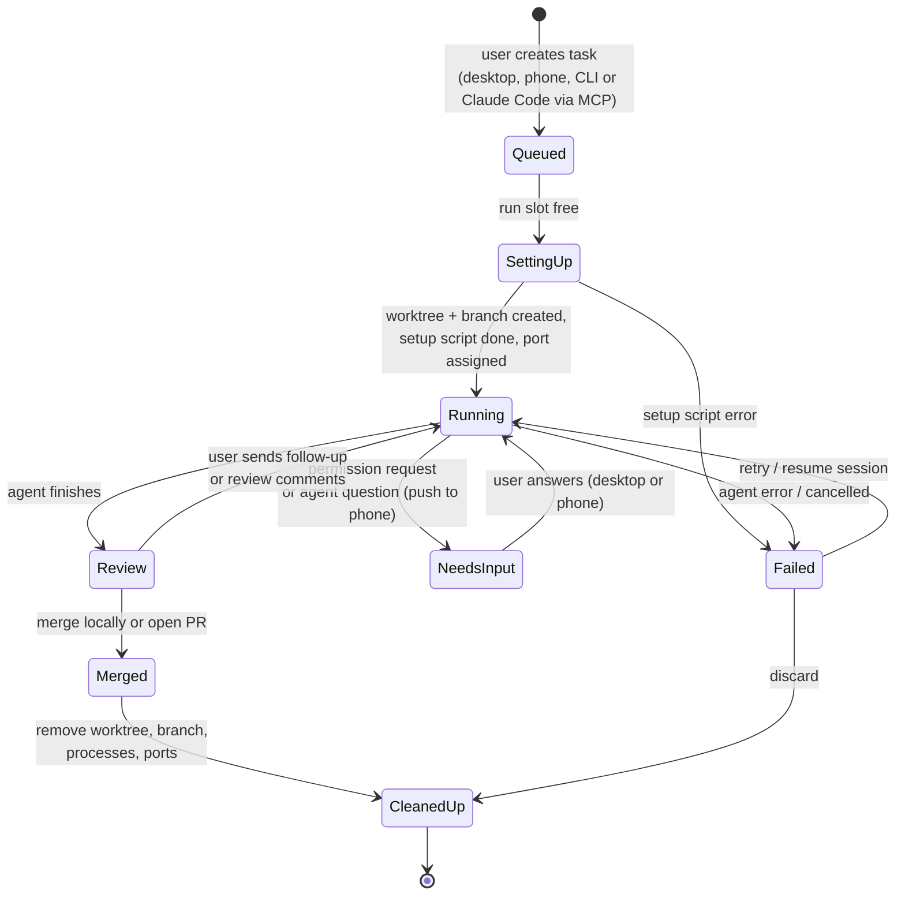
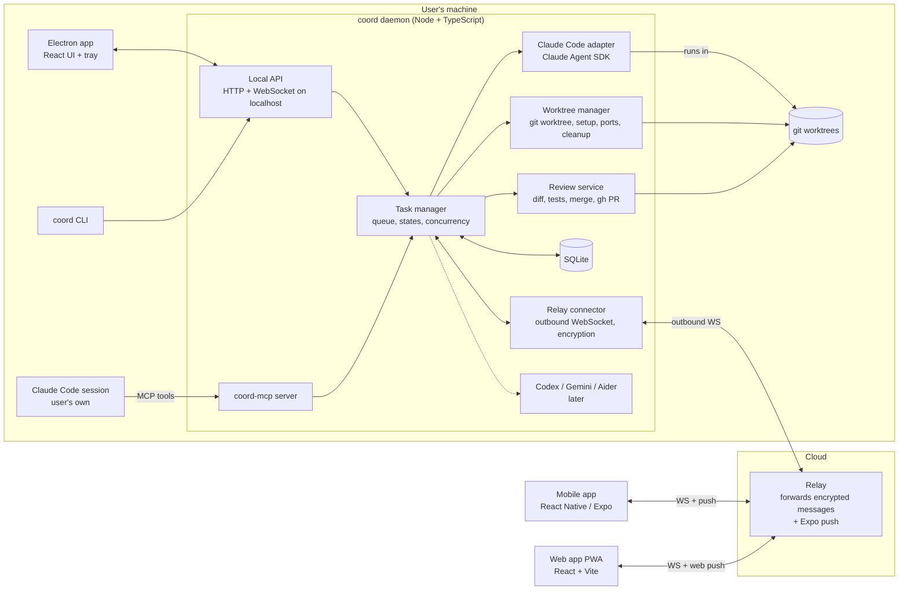

# PRD: Coord — run coding agents in parallel git worktrees

**Date:** 2026-10-26 · **Status:** Draft v0.5 · **Name:** Coord (command `coord`)

**Changes in v0.5:**

- Renamed to **Coord** (was "Worktree Orchestrator" / `wto`).
- Codex joins Claude Code in v1, through `codex app-server`, at full parity (permission prompts, steering, interrupts).
- The PWA ships before the Expo mobile app. Electron stays the desktop app.
- "Merge" means pushing the branch and opening a GitHub pull request.
- Hosting uses subdomains of `shekharkumar.com` (`coord.shekharkumar.com`, `relay.coord.shekharkumar.com`). All URLs are configurable.
- The Phase 1 design is being written up separately.

**Changes in v0.4:**

- Added an installable web app (PWA) with the same session control as the mobile app.
- The desktop app and the web app share one UI package.
- The monorepo moves from Turborepo to **Nx** (pnpm workspaces, package-based). Nx enforces package boundaries and has a generator for new packages.
- Phase 0 is now "skeleton hardening": no feature work until the skeleton passes every check.

**Changes in v0.3:**

- Decided: an Electron desktop app plus a React Native (Expo) mobile app, in one monorepo.
- The orchestrator now runs as its own background process (the "daemon"), separate from the desktop app.
- Added a relay server so the phone can control the desktop.
- Added Phase 5: triggers and integrations.

---

## 1. Overview and problem

We are building an app that runs several coding agents in parallel on one repo. Each feature gets its own git worktree, and the app takes it from task to reviewed, merged code.

It has four parts:

- **Desktop app (Electron).** Where the agents run, and where you review and merge their work.
- **Mobile app (React Native).** Watch, approve and steer the same agents from your phone while they keep running on your desktop.
- **Web app (installable PWA).** The same remote control from any browser, installable on a phone's home screen without an app store. It uses the same screens as the desktop app.
- **CLI and MCP server.** Let scripts and Claude Code itself drive the orchestrator.

**Claude Code is the first and most important integration.** Every design choice in v1 keeps Claude Code fully supported, in both directions:

- **We drive Claude Code.** The app starts and controls Claude Code sessions.
- **Claude Code drives us.** From inside a Claude Code session, you can create and manage parallel tasks.

Other agents (Codex CLI, Gemini CLI, Aider) come later, through the same adapter interface.

Coding agents are now good enough that a developer could keep 3 to 5 of them busy at once. In practice they run one or two, because every parallel session needs manual work:

- **Setup:** creating a worktree and branch, copying `.env`, installing dependencies and picking a free port, by hand for every task.
- **Tracking:** one terminal tab per agent, with no single view of which agent is working, stuck, waiting for permission or done.
- **Collisions:** parallel features touch the same files, so the conflicts show up late, at merge time.
- **Review:** the agents can produce diffs faster than one person can review, test and merge them.
- **Cleanup:** finished worktrees, branches and dev servers pile up.
- **Tied to the desk:** an agent waiting for permission sits idle until you're back at the keyboard.
- **Agent lock-in:** every agent has its own CLI, output format and session model, so changing agents means changing workflow.

---

## 2. Goals and non-goals

v1 succeeds if one developer can run 3 or more Claude Code tasks in parallel on one repo, and:

- each task goes from description to merged branch without the developer touching a terminal or git;
- every approval and question can be answered from the phone.

### Goals (v1)

1. **Full Claude Code integration.** The repo's own Claude Code setup (`CLAUDE.md`, settings, hooks, MCP servers, skills, subagents) works the same inside an orchestrated task as in a normal session.
2. **Two-way integration.** Claude Code can call the orchestrator through an MCP server and a CLI, so it can create, check and merge parallel tasks.
3. **One-step setup.** One command or click creates an isolated, ready-to-run worktree with its branch, env files, dependencies and port.
4. **Live view.** Every task's progress, tool calls and cost stream live to the desktop app, and all tasks share one status view.
5. **Answer agents from anywhere.** Permission requests and agent questions can be answered from the desktop or the phone.
6. **Review in the app.** Each task gets a diff view and test results, then a one-click merge or PR.
7. **Phone control.** The mobile app and the installed web app (PWA) can both create tasks, show status and summaries, approve, answer, send follow-ups, and merge or open a PR.
8. **Cleanup.** The worktree, branch, processes and ports go away when a task closes.
9. **Agent-neutral core.** An adapter interface keeps the core free of agent specifics, so adding a second agent needs no core changes.
10. **Runs without a window.** The daemon keeps running when the desktop window is closed, and can run on a machine with no screen at all.

### Non-goals (v1)

- **Replacing the agents.** We orchestrate existing CLIs and SDKs; we build no model loop of our own.
- **Running code in the cloud.** Agents run on the user's machine. The relay only forwards encrypted messages and push notifications; it never runs code or stores it.
- **Detailed code review on the phone.** The phone shows summaries, test results and the list of changed files. Line-by-line review stays on the desktop.
- **Team features.** No multi-user features: shared queues, permissions or billing.
- **An editor.** Users open worktrees in their own editor.
- **AI task planning.** v1 does not split features into tasks automatically. The user writes the tasks.
- **General app automation.** Emails, CRM updates and the like are out of scope. Agents can still reach other apps through the repo's MCP servers.
- **Windows desktop support.** The v1 desktop app targets macOS and Linux. The mobile app targets iOS and Android.

---

## 3. Target users

The v1 user is a solo developer or small-team engineer who already uses Claude Code every day and wants to run more work in parallel, including while away from the desk.

| Persona                          | Who                                                                            | Main need                                                                                   | Phase                 |
| -------------------------------- | ------------------------------------------------------------------------------ | ------------------------------------------------------------------------------------------- | --------------------- |
| Claude Code power user (primary) | Indie developer or startup engineer with 1 to 3 repos, using Claude Code daily | Run 3 to 5 features at once without juggling terminals, and keep them moving from the phone | v1                    |
| Multi-agent tinkerer             | Developer who tries Codex, Gemini CLI and Claude Code on the same task         | Pick the agent per task, or run two agents on one task and compare                          | Phase 6               |
| Tech lead                        | Lead of a 3 to 10 person team                                                  | Hand tasks to agents and review their output like a teammate's                              | Later (team features) |

---

## 4. Competitive landscape and differentiation

Several tools already run agents in parallel worktrees. Our proposed edge has three parts, all to be tested in Phase 0:

- the deepest Claude Code integration, in both directions;
- a review-to-merge loop built for one person reviewing many agents;
- a real mobile app for controlling everything from the phone.

> The table below is from memory, not researched. Check each tool's current features before we commit.

| Tool               | Approach (approximate, to verify)                                                                                        |
| ------------------ | ------------------------------------------------------------------------------------------------------------------------ |
| Conductor          | Mac app that runs several Claude Code agents, each in its own worktree                                                   |
| Crystal            | Desktop app for parallel Claude Code sessions in worktrees                                                               |
| Claude Squad       | Terminal UI that manages several agents through tmux and worktrees                                                       |
| Vibe Kanban        | Kanban board that hands tasks to coding agents                                                                           |
| Sculptor           | Runs agents in containers, so each one is sandboxed                                                                      |
| Claude Code itself | Built-in worktree support and subagents. Remote Control can steer a single local session from the Claude app or website. |

**Where we could stand out**

- **Two-way Claude Code integration:** Claude Code can start and manage parallel tasks through our MCP server. Other tools mostly launch Claude Code; they don't let it call back.
- **Repo setup kept intact:** the repo's own `CLAUDE.md`, hooks, MCP servers and skills load in every worktree, unchanged.
- **Many tasks from the phone:** an approval inbox, push notifications and one-tap merge across all parallel tasks, not just a single session.
- **Review first:** diffs, test results and conflict warnings across all running tasks.
- **Early collision warnings:** spot two tasks editing the same files while they run, not at merge time.
- **Any agent, later:** one interface for Codex, Gemini CLI and Aider, chosen per task.

---

## 5. Core workflow and user stories



### User stories

1. **Start several features.** As a developer, I write three task descriptions and start them. Each runs in its own worktree with Claude Code, and I keep working in my main checkout.
2. **Spawn from Claude Code.** While pairing with Claude Code, I say "split this into three parallel tasks." Claude Code calls the orchestrator's MCP tools to create them, then reports their progress back to me.
3. **Keep the repo's setup.** When a task starts, Claude Code loads the repo's `CLAUDE.md`, project settings, hooks and MCP servers, just as in a normal session.
4. **Answer permission requests.** When an agent asks to run a command, I get a notification and approve or deny it on the desktop. "Always allow" adds the command to that repo's allowlist.
5. **Approve from the phone.** I'm away from my desk and get a push notification: "Task 2 wants to run `pnpm add zod`." I approve it from the notification, and the agent continues.
6. **Start a task from the phone.** On the train, I type or speak "add CSV export to reports page," pick the repo, and it starts on my desktop.
7. **Review and give feedback.** When a task finishes, I see its diff and test results on the desktop. On the phone I see a summary, test status and changed files. Comments from either go back to the same Claude Code session, which continues where it stopped.
8. **Get collision warnings.** When two running tasks edit the same file, I'm warned right away.
9. **Merge and clean up.** I merge with one click (squash into the base branch) or open a PR, from the desktop or the phone (with a confirmation step on the phone). The worktree, branch, dev server and port are cleaned up.
10. **Glance at the tray.** The desktop tray icon shows "2 running · 1 needs you" without my opening the window.
11. **Recover after a restart.** If the app or my machine restarts, tasks keep their state and I can resume each Claude Code session by its ID.

---

## 6. Functional requirements

The MVP is P0 only:

- deep Claude Code integration
- the full worktree lifecycle
- the desktop app
- phone control for the key actions

Other agents, AI planning and triggers are P2.

| ID    | Area        | Requirement                                                                                                                          | Priority |
| ----- | ----------- | ------------------------------------------------------------------------------------------------------------------------------------ | -------- |
| FR-1  | Claude Code | Run Claude Code through the Claude Agent SDK, with `cwd` set to the task's worktree                                                  | P0       |
| FR-2  | Claude Code | Load the repo's own Claude Code setup in every worktree: `CLAUDE.md`, `.claude/settings.json`, hooks, MCP servers, skills, subagents | P0       |
| FR-3  | Claude Code | Stream SDK events live: assistant text, tool calls, file edits, token usage, cost                                                    | P0       |
| FR-4  | Claude Code | Show permission requests to all connected clients for approve or deny, with a per-repo allowlist                                     | P0       |
| FR-5  | Claude Code | Resume a session by ID for follow-ups after a run ends or the daemon restarts                                                        | P0       |
| FR-6  | Claude Code | Ship an MCP server so Claude Code can create, list, check, message and merge tasks                                                   | P0       |
| FR-7  | Claude Code | Ship a CLI (`coord`) that Claude Code or the user can call from any shell                                                            | P0       |
| FR-8  | Claude Code | Choose model and permission mode per task                                                                                            | P1       |
| FR-9  | Claude Code | Attach mode: track Claude Code sessions the user started by hand in a worktree, using Claude Code hooks (`Stop`, `Notification`)     | P1       |
| FR-10 | Claude Code | Fallback adapter using `claude -p --output-format stream-json`, for when the SDK isn't available                                     | P2       |
| FR-11 | Worktrees   | Register a repo and detect its base branch and package manager                                                                       | P0       |
| FR-12 | Worktrees   | Create a task's worktree on a new branch `agent/<slug>` from the base branch                                                         | P0       |
| FR-13 | Worktrees   | Run a per-repo setup script in each new worktree to copy env files and install dependencies                                          | P0       |
| FR-14 | Worktrees   | Give each worktree a unique port range, passed in as environment variables                                                           | P0       |
| FR-15 | Worktrees   | On close, remove the worktree and branch, stop its processes and free its ports                                                      | P0       |
| FR-16 | Desktop     | List every task with status, branch, elapsed time and cost                                                                           | P0       |
| FR-17 | Desktop     | Cancel a run; send follow-up messages to a running agent                                                                             | P0       |
| FR-18 | Desktop     | Cap concurrent runs (default 3) and queue the rest                                                                                   | P1       |
| FR-19 | Desktop     | Desktop notification when a task needs input, finishes or fails                                                                      | P1       |
| FR-20 | Review      | Show each task's diff against its base branch                                                                                        | P0       |
| FR-21 | Review      | Run the repo's test and lint commands in the worktree and show the results                                                           | P0       |
| FR-22 | Review      | Merge locally (squash or rebase) or open a PR with `gh`                                                                              | P0       |
| FR-23 | Review      | Send review comments back to the agent as a follow-up turn                                                                           | P1       |
| FR-24 | Review      | Warn when two active tasks edit the same files                                                                                       | P1       |
| FR-25 | Review      | Rebase a task onto the latest base and let the agent resolve conflicts                                                               | P2       |
| FR-26 | Agents      | Adapters for Codex CLI, Gemini CLI and Aider, chosen per task                                                                        | P2       |
| FR-27 | Agents      | Give one task to two agents and compare the diffs                                                                                    | P2       |
| FR-28 | Planning    | Split a feature into tasks that touch different files                                                                                | P2       |
| FR-29 | Isolation   | Optionally run a task inside a container                                                                                             | P2       |
| FR-30 | Desktop     | The Electron app starts the daemon if it isn't running and restarts it if it crashes; closing the window leaves the daemon running   | P0       |
| FR-31 | Desktop     | Tray or menu-bar icon with counts (running, needs input, ready for review) and quick actions                                         | P1       |
| FR-32 | Mobile      | Pair a phone with the desktop by scanning a QR code; list and revoke paired devices                                                  | P0       |
| FR-33 | Mobile      | Task list and task detail: status, live agent messages, cost, summary, test results, changed files                                   | P0       |
| FR-34 | Mobile      | Approval inbox: every pending permission request and agent question, answered with one tap                                           | P0       |
| FR-35 | Mobile      | Push notifications for needs input, done and failed, with approve/deny on the notification where the OS allows                       | P0       |
| FR-36 | Mobile      | Create a task: pick the repo, type the description, choose the agent and model                                                       | P0       |
| FR-37 | Mobile      | Send follow-ups; merge or open a PR, confirmed with Face ID / biometrics                                                             | P0       |
| FR-38 | Mobile      | Voice input for new tasks and follow-ups                                                                                             | P1       |
| FR-39 | Mobile      | Daily digest: tasks done, PRs ready, spend                                                                                           | P2       |
| FR-40 | Relay       | The daemon connects outbound to the relay; the phone connects to the relay; the relay passes messages both ways                      | P0       |
| FR-41 | Relay       | Messages are encrypted from phone to daemon; the relay only sees routing data                                                        | P0       |
| FR-42 | Relay       | The relay sends push notifications through Expo Push                                                                                 | P0       |
| FR-43 | Relay       | On a local network, the phone connects directly to the daemon, skipping the relay                                                    | P2       |
| FR-44 | Triggers    | Scheduled coding tasks (e.g. nightly dependency update) that each produce a PR                                                       | P2       |
| FR-45 | Triggers    | Create tasks from GitHub issues or Linear tickets with a label, and from failed CI runs                                              | P2       |
| FR-46 | Triggers    | Slack or email notification on task state changes                                                                                    | P2       |
| FR-47 | Web         | Installable PWA (manifest, service worker, offline shell) that works on iOS, Android and desktop browsers                            | P0       |
| FR-48 | Web         | Same remote features as the mobile app (FR-33 to FR-37), through the relay, paired by QR code or pairing link                        | P0       |
| FR-49 | Web         | Uses the same screens as the desktop app, from `packages/ui-web`                                                                     | P0       |
| FR-50 | Web         | Web Push notifications for installed PWAs (iOS needs 16.4 or later and the app added to the home screen)                             | P1       |

---

## 7. Claude Code integration and the agent adapter

Claude Code has two integration surfaces, and v1 builds both.

### 7.1 Outbound: the orchestrator drives Claude Code

The main path is the **Claude Agent SDK** (TypeScript, `@anthropic-ai/claude-agent-sdk`). It runs inside the daemon, which is a plain Node process. Its `query()` call takes the options we need:

| Need                      | SDK feature we rely on                                                                                                                                                                                                                                                                                                |
| ------------------------- | --------------------------------------------------------------------------------------------------------------------------------------------------------------------------------------------------------------------------------------------------------------------------------------------------------------------- |
| Run in the worktree       | `cwd` = worktree path                                                                                                                                                                                                                                                                                                 |
| Keep the repo's own setup | `settingSources: ['user', 'project', 'local']`, so `CLAUDE.md`, `.claude/settings.json`, hooks and project MCP servers load. SDK 0.3 loads all sources when the option is omitted, but we set it explicitly so a future default change can't silently drop the repo's setup. `'project'` is required for `CLAUDE.md`. |
| Permission UI             | `canUseTool` callback → becomes a pending "needs input" event, sent to the desktop and to the phone (as a push notification); `permissionMode` per task                                                                                                                                                               |
| Live stream               | async iterator of messages: `system` (init, gives `session_id`), `assistant`, `user` (tool results), `result` (cost, usage, duration)                                                                                                                                                                                 |
| Follow-ups and restarts   | `resume: <session_id>`; we store the session ID per task                                                                                                                                                                                                                                                              |
| Cancel                    | an `AbortController` passed to the query                                                                                                                                                                                                                                                                              |
| Extra tools for the agent | `mcpServers`, used to inject the orchestrator's own MCP server (e.g. "report progress", "ask the user")                                                                                                                                                                                                               |

> Check these option names against the current SDK docs when we start building. The SDK changes quickly.

**Fallback:** a headless CLI adapter that runs `claude -p "<prompt>" --output-format stream-json --verbose` and uses `--resume <id>` for follow-ups (FR-10). It parses the same event types.

### 7.2 Inbound: Claude Code drives the orchestrator

- **MCP server (`coord-mcp`).** Tools: `create_task`, `list_tasks`, `get_task` (status, diff summary, test results), `send_message`, `merge_task`, `discard_task`. The user adds it once with `claude mcp add`. From then on, any Claude Code session can spread work across parallel tasks.
- **CLI (`coord`).** The same operations as shell commands (`coord new "add dark mode"`, `coord ls`, `coord merge <id>`), so Claude Code can also use it through Bash, and so can scripts.
- **Hooks (attach mode, P1).** An optional `.claude/settings.json` snippet whose `Stop` and `Notification` hooks call `coord hook …`. Sessions the user starts by hand still show up in the dashboard and on the phone.

### 7.3 Adapter interface (agent-neutral core)

```ts
interface AgentAdapter {
  id: "claude-code" | "codex" | "gemini" | "aider";
  capabilities: { resume: boolean; permissionCallback: boolean; costReporting: boolean };
  start(task: TaskSpec, cwd: string, signal: AbortSignal): AsyncIterable<AgentEvent>;
  resume(sessionId: string, message: string, cwd: string, signal: AbortSignal): AsyncIterable<AgentEvent>;
}

type AgentEvent =
  | { type: "session"; sessionId: string }
  | { type: "text"; text: string }
  | { type: "tool_call"; toolUseId: string; name: string; input: unknown }
  | { type: "tool_result"; toolUseId: string; ok: boolean }
  | { type: "permission_request"; requestId: string; tool: string; input: unknown }
  | { type: "usage"; inputTokens: number; outputTokens: number; costUsd?: number }
  | { type: "done"; summary?: string }
  | { type: "error"; message: string };
```

Rules:

- **Claude Code sets the bar.** The interface is designed around Claude Code first. Other adapters declare what they can't do through `capabilities`, and the UI hides those features for them. We never cut a Claude Code feature to fit a weaker agent.
- **No agent-specific code in the core.** The core (task store, worktree manager, clients) never imports agent-specific code.

---

## 8. Non-functional requirements

| Area                | Requirement                                                                                                                                                                                                                                                                                                         |
| ------------------- | ------------------------------------------------------------------------------------------------------------------------------------------------------------------------------------------------------------------------------------------------------------------------------------------------------------------- |
| Safety              | The default permission mode asks before running shell commands or editing files outside the worktree. Bypass mode needs per-repo opt-in on the desktop (never from the phone) and shows a visible warning.                                                                                                          |
| Isolation           | An agent's `cwd` is its worktree. The setup script never writes outside the worktree.                                                                                                                                                                                                                               |
| Local security      | The daemon requires a random per-start token on every request except `/health`. The token is stored in an owner-only file (`~/.coord/daemon-<port>.json`, mode 0600), so other OS users and local web pages can't control it. The daemon also rejects a non-local Host and any browser Origin outside an allowlist. |
| Remote security     | Phones pair by QR code using a key exchange; each device has its own keys and can be revoked. Merge and other risky actions on the phone need biometric confirmation. The daemon never listens on a public port.                                                                                                    |
| Relay privacy       | Messages between phone and daemon are encrypted so the relay can't read them (e.g. libsodium sealed boxes). The relay stores no code, diffs or prompts; only device IDs, push tokens and messages briefly queued while a device is offline.                                                                         |
| Protocol versioning | Every message carries a protocol version. The daemon supports the current and previous minor version, because the phone app updates slower than the desktop.                                                                                                                                                        |
| Persistence         | Tasks, session IDs, events and costs are stored in SQLite. They survive daemon restarts and crashes, and running tasks are marked "interrupted, resumable".                                                                                                                                                         |
| Performance         | Up to 5 concurrent agents on a 16 GB laptop. Events reach the desktop UI within 500 ms and the phone within 2 s over the relay. Worktree creation, excluding dependency install, takes under 5 s.                                                                                                                   |
| Availability        | Agents run only while the host machine is awake. The desktop app offers "keep awake while tasks run". The daemon can run with no window or screen (Mac mini, home server, later a cloud VM).                                                                                                                        |
| Cost visibility     | Token use and cost are shown per task and per day, with an optional daily budget that pauses the queue.                                                                                                                                                                                                             |
| Git hygiene         | Every orchestrator branch uses the `agent/` prefix. The app never force-pushes or touches branches it didn't create.                                                                                                                                                                                                |
| Privacy             | No telemetry unless the user turns it on. API keys come from the user's existing Claude Code login or environment and never leave the desktop.                                                                                                                                                                      |
| Platforms           | Desktop: macOS and Linux, git 2.40 or later (the repo pins Node 24 LTS for development). Mobile: iOS 16 or later, Android 10 or later. Web: current Safari, Chrome, Firefox and Edge.                                                                                                                               |

---

## 9. Architecture and tech stack

### 9.1 Key decision: the daemon is separate from Electron

The orchestrator core runs as a **separate background process** (the daemon). The Electron app starts it and restarts it if it crashes, but it is only one client of the daemon. This means:

- **Agents keep running** when the desktop window is closed.
- **The CLI, MCP server and phone** talk to the daemon directly, not through Electron.
- **The same daemon runs on a headless machine** for 24/7 use, without changing the code.
- **No Electron-specific native builds.** Native Node modules like `better-sqlite3` run under plain Node, so they need no Electron rebuild.



### 9.2 Monorepo layout

The repo uses **pnpm workspaces + Nx** (package-based: each package keeps its own `package.json` scripts; Nx adds the project graph, caching, boundary rules and generators). `apps/` holds runnable programs and `packages/` holds libraries.

```
coord/
  apps/
    desktop/              Electron shell: main starts the daemon + bridges IPC; renderer mounts @coord/ui-web
    web/                  installable PWA (Vite + vite-plugin-pwa); mounts @coord/ui-web
    mobile/               Expo (React Native) app
    relay/                WebSocket relay + push (Node; can move to Cloudflare Workers + Durable Objects)
    cli/                  the `coord` command
    mcp-server/           coord-mcp, so Claude Code can drive the orchestrator
  packages/
    protocol/             zod schemas: tasks, agent events, pushed-event envelope, errors, protocol version
    client/               typed daemon client over a pluggable Transport (request + subscribe)
    app-state/            React hooks shared by ui-web and mobile (no DOM, no React Native)
    ui-web/               React DOM screens and components shared by desktop and web
    design-tokens/        colors, spacing, type scale, shared by every UI
    core/                 the daemon: HTTP API, /events WebSocket, event bus, task store
    adapter-claude-code/  Claude Agent SDK adapter (P0)
    tsconfig/             shared TypeScript configs
  tools/
    workspace-plugin/     local Nx generators (`nx g @coord/workspace-plugin:library`) + repo invariants test
```

Daemon internals added in Phase 1 (worktree manager, SQLite store) are `type:service` packages: only the daemon may import them.

**Monorepo rules (enforced by lint, not just written down)**

1. **`protocol` is the contract.** Clients and daemon talk only through types and schemas in `protocol`. No client imports `core`.
2. **Share logic everywhere; share screens only between React DOM apps.** Desktop and web share `ui-web`. Mobile shares `app-state`, `client`, `protocol` and `design-tokens`, but has its own screens.
3. **Boundaries are checked.** Every project has an Nx `type:` tag and a `platform:` tag. `@nx/enforce-module-boundaries` fails lint when:
   - a `platform:node` package is pulled into a UI;
   - a library imports an app;
   - `ui-web` is imported by mobile.
4. **New packages come from the generator,** so every package has the same scripts (`typecheck`, `lint`, `test`), tsconfig, tags and layout.
5. **pnpm's default layout.** Expo SDK 58 configures Metro for monorepos and supports pnpm's default layout, so no hoisting is needed. There must be exactly one copy of `react` and `react-native` in the repo.

### 9.3 Stack

- **Daemon (`packages/core`):** Node 20+, TypeScript, Fastify (HTTP + WebSocket), `better-sqlite3`, `execa` for git and `gh`.
- **Claude Code:** `@anthropic-ai/claude-agent-sdk`. MCP server built with `@modelcontextprotocol/sdk`.
- **Workspace:** Node 24 LTS (pinned through pnpm `use-node-version`), pnpm 10, Nx 24, TypeScript 6, ESLint 10 + typescript-eslint, Prettier, Vitest. CI runs `pnpm check` (every project) on GitHub Actions.
- **Desktop (`apps/desktop`):** Electron + electron-vite. The window renders `@coord/ui-web`. For diffs, `react-diff-view` or Monaco's diff editor. Packaged with electron-builder.
- **Web (`apps/web`):** Vite + React + `vite-plugin-pwa` (manifest, service worker), rendering `@coord/ui-web`.
- **Mobile (`apps/mobile`):** Expo (React Native) with Expo Router, Expo Notifications, expo-local-authentication (biometrics) and expo-camera (QR pairing).
- **Relay (`apps/relay`):** Node + `ws` to start. It can move to Cloudflare Workers + Durable Objects later. Push goes through the Expo Push API.
- **Crypto:** libsodium (`libsodium-wrappers` on desktop and relay, a React Native compatible build on mobile).
- **Repo config:** `.coord/config.json` in each managed repo (setup script, test command, port range, env files to copy), committed so the team shares it.

### 9.4 Remote access design (Phase 4)

The UI and the data reach the phone by different paths.

**The UI.** The PWA (`apps/web`) is served as static files over HTTPS by the project (e.g. `https://app.coord.dev`). It holds no user data and no server logic. It can't be served from the desktop for three reasons:

- Phones only install PWAs, run service workers and receive Web Push over HTTPS.
- Away from home, the desktop is unreachable: the router blocks incoming connections, and the daemon binds to `127.0.0.1`.
- Browsers block an HTTPS page from calling a plain-HTTP local address (mixed content).

**The data: an encrypted relay, paired by QR code.**

```
Phone (PWA from app.coord.dev) ──wss──▶ Relay (ciphertext only) ◀──wss (outbound)── Desktop daemon
           ◀════════════ end-to-end encrypted (X25519 + XChaCha20-Poly1305, libsodium) ════════════▶
```

1. **QR code.** "Connect phone" on the desktop shows a QR code for `https://app.coord.dev/pair#relay=…&room=…&key=<desktop public key>&secret=<one-time code>`. The `#` fragment is never sent to a server.
2. **Handshake.** The phone generates a keypair. The two sides run a handshake through the relay, authenticated by the one-time secret the relay never sees, and derive a shared session key.
3. **Encrypted traffic.** Every request and pushed event is encrypted on one device and decrypted only on the other.
   - The relay forwards bytes it can't read.
   - The daemon only connects outward, so no ports are opened on the user's network.
4. **Reconnects.** The phone keeps its keys and reconnects automatically. A reconnecting client asks for missed events by `seq`. The desktop lists paired devices and can revoke each one (FR-32).

`@coord/client` gets a relay `Transport`; the apps don't change. The native Expo app uses the same pairing and relay.

**Relay hosting (open source).**

- **Default:** a public relay run by the project, e.g. on Cloudflare Workers + Durable Objects. It stores nothing and sees only ciphertext.
- **Self-hosting:** users can run the relay themselves (`apps/relay`, Docker or Worker) and set its URL in the app.
- **Own private network:** power users can skip the relay, e.g. Tailscale with HTTPS.

**Trust in the hosted UI.** The remaining risk is a swapped hosted bundle. The mitigation: versioned, immutable deploys built from tagged releases by CI, plus a self-hostable PWA and the native app.

**Later.** When phone and desktop share a network, upgrade to a direct WebRTC data channel, still end-to-end encrypted. The relay only introduces the two sides. WebRTC is allowed from an HTTPS page, so it avoids the mixed-content block.

---

## 10. Success metrics

| Metric                                             | v1 target                                                                                                         |
| -------------------------------------------------- | ----------------------------------------------------------------------------------------------------------------- |
| Concurrent tasks per user session                  | Median 3 or more                                                                                                  |
| Task merge rate (merged ÷ started)                 | 60% or more                                                                                                       |
| Time from "create task" to agent running           | Under 60 s, including dependency install with a warm cache                                                        |
| Tasks finished without the user opening a terminal | 80% or more                                                                                                       |
| Permission requests answered from the phone        | 30% or more (shows the phone is really used)                                                                      |
| Time from push notification to agent unblocked     | Median under 2 minutes                                                                                            |
| Claude Code setup kept intact                      | 100% of the repo's `CLAUDE.md`, hooks and MCP servers load in an orchestrated task (checked by an automated test) |
| Leftover worktrees and branches after cleanup      | 0                                                                                                                 |

---

## 11. Release plan

```mermaid
flowchart LR
    P0["Phase 0 · 1 week<br/>Skeleton hardening:<br/>all apps + packages lint,<br/>typecheck, test, build, CI;<br/>boundaries + generator;<br/>dogfood 3 Claude Code sessions"] --> G0{Gate: skeleton green<br/>on CI, reviewed,<br/>top pains confirmed}
    G0 --> P1["Phase 1 · 2 weeks<br/>protocol + core +<br/>Claude Code adapter + CLI,<br/>SQLite, worktree manager"]
    P1 --> G1{Gate: one task<br/>end-to-end from CLI,<br/>repo's CLAUDE.md honored}
    G1 --> P2["Phase 2 · 2 weeks<br/>coord-mcp server +<br/>Electron app: live events,<br/>permissions, 3 parallel tasks"]
    P2 --> G2{Gate: Claude Code<br/>spawns tasks via MCP}
    G2 --> P3["Phase 3 · 2 weeks<br/>Review loop: diff, tests,<br/>merge / PR, cleanup,<br/>overlap warnings, tray"]
    P3 --> G3{Gate: 1 week of<br/>daily desktop use}
    G3 --> P4["Phase 4 · 4 weeks<br/>Relay + mobile app + PWA:<br/>pairing, approvals inbox,<br/>push, create, merge"]
    P4 --> G4{Gate: full day<br/>steered from phone}
    G4 --> P5["Phase 5<br/>Triggers: scheduled tasks,<br/>issue / CI to task,<br/>Slack notifications"]
    G4 --> P6["Phase 6<br/>Codex / Gemini / Aider<br/>adapters, planner,<br/>containers"]
```



**Re-scoped on 2026-10-26.** Phase 1 now covers the full local loop (CLI, desktop board, checks, GitHub PRs) for Claude Code **and** Codex, run from the repo. See [the Phase 1 design](superpowers/specs/2026-10-26-phase-1-design.md). Packaging (installable app, npm CLI) is the next phase, before relay + PWA + mobile.

The durations are estimates for one developer working part-time. Each gate must pass before the next phase starts. Phases 5 and 6 can run in either order.

---

## 12. Risks and mitigations

| Risk                                                                                                               | Impact                                       | Mitigation                                                                                                                                                                               |
| ------------------------------------------------------------------------------------------------------------------ | -------------------------------------------- | ---------------------------------------------------------------------------------------------------------------------------------------------------------------------------------------- |
| Claude Agent SDK or CLI changes break the adapter                                                                  | Core feature breaks                          | Pin SDK version; adapter contract tests run against real `claude`; keep CLI fallback adapter                                                                                             |
| Repo's Claude Code setup doesn't load the same way in worktrees (e.g., `.claude/settings.local.json` is untracked) | Agents behave differently than in normal use | Setup script copies untracked `.claude/*.local.*` files; integration test asserts hooks/MCP load                                                                                         |
| Remote control is a path to running code on the user's machine                                                     | Severe security incident                     | Encryption from phone to daemon; per-device keys with revocation; daemon only connects outbound; biometric confirmation for risky actions; bypass mode can't be turned on from the phone |
| Desktop sleeps, or the laptop lid closes                                                                           | Agents stop and the phone shows stale state  | "Keep awake while tasks run"; the phone shows "host offline since …"; document running the daemon on an always-on machine                                                                |
| React Native + pnpm monorepo problems (Metro, duplicate React)                                                     | Lost days on tooling                         | Single pinned React/React Native version; the Expo bundle is built in CI from day one                                                                                                    |
| PWA limits on iOS (push only for home-screen apps on iOS 16.4+, no background sync)                                | PWA users miss notifications                 | The PWA prompts users to install it; the native mobile app stays the main phone client; email digest as a fallback                                                                       |
| Agents (and people) break the structure as the repo grows                                                          | Slow, tangled codebase                       | Nx boundary rules in lint + CI, a generator for new packages, `AGENTS.md` rules loaded by Claude Code                                                                                    |
| Phone app version lags the desktop                                                                                 | Broken commands                              | Protocol versioning; the daemon supports N-1; the app shows "update required"                                                                                                            |
| Parallel tasks collide on the same files                                                                           | Painful merges, wasted runs                  | Overlap warnings (FR-24); encourage small, file-scoped tasks; rebase + agent-assisted conflict fix (FR-25)                                                                               |
| Port, database or cache clashes between worktrees                                                                  | Flaky dev servers and tests                  | Per-worktree port range and env vars; documented pattern for per-task DB (e.g., SQLite file or schema per task)                                                                          |
| Agent runs a harmful command unattended                                                                            | Data loss                                    | Default ask-permission mode; allowlist; bypass needs explicit opt-in; containers in Phase 6                                                                                              |
| Cost overruns from many parallel agents                                                                            | User distrust                                | Per-task cost display, daily budget pause, concurrency cap                                                                                                                               |
| Existing tools already cover the use case                                                                          | Low adoption                                 | Phase 0 gate: confirm that two-way Claude Code integration, the review loop and multi-task phone control are real gaps                                                                   |
| Disk use from many worktrees with `node_modules`                                                                   | Fills disk                                   | Prefer pnpm (shared store); auto-cleanup; disk warning                                                                                                                                   |

---

## 13. Open questions

**Decided in v0.3–v0.4:**

- Form factor: an Electron desktop app, a React Native (Expo) mobile app, and an installable web app (PWA).
- Repo: one pnpm + Nx monorepo.
- Process model: a separate daemon process.
- Audience: fully open source. The project hosts the static PWA; the remote-access design is in §9.4.
- Name: **Coord**. Hosted at `coord.shekharkumar.com`; the relay at `relay.coord.shekharkumar.com`.
- Agents in v1: Claude Code and Codex. Clients in v1: Electron desktop and the PWA; Expo follows.
- Merge: open a GitHub pull request.

**Still open:**

- [ ] **License.** MIT or Apache-2.0?
- [ ] **Public relay.** Does the project run a default public relay (proposed: Cloudflare Workers), or is the relay self-host only?
- [ ] **Merge default.** Squash-merge locally, or always open a PR?
- [ ] **Worktree location.** Next to the repo (`../repo-agent-<slug>`) or under `~/.coord/worktrees/<repo>/<slug>`?
- [ ] **Auth.** Is reusing the user's Claude Code login enough, or do we also support an API key per repo?
- [ ] **Competitor check.** In Phase 0, verify the current features of Conductor, Crystal, Claude Squad, Vibe Kanban and Claude Code Remote Control.
- [ ] **Second agent.** Which non-Claude agent comes first in Phase 6: Codex CLI or Gemini CLI?

**Deferred from the Phase 0 skeleton review (2026-10-26)**

The skeleton reviews raised these. Each belongs to a feature phase, so it is tracked here rather than built into the skeleton.

| Item                                                                                                               | Phase                | Note                                                            |
| ------------------------------------------------------------------------------------------------------------------ | -------------------- | --------------------------------------------------------------- |
| Cost accounting from the SDK's `modelUsage` (includes subagents and cache tokens) instead of the main-loop `usage` | 1                    | The adapter currently reports main-loop tokens only             |
| Subagent events (`parent_tool_use_id`) nested under their parent tool call                                         | 1                    | Today they show up as top-level text and tool events            |
| `RepoConfig` schema for `.coord/config.json` and a daemon data directory for SQLite                                | 1                    | Needed by the worktree manager and store                        |
| Replay of missed events after reconnect (`/events?since=<seq>`)                                                    | 2 / 4                | The `seq` field is already in the envelope                      |
| Bundled daemon for the packaged desktop app                                                                        | 2                    | Dev spawns it through pnpm; packaged builds throw a clear error |
| Per-worktree daemon port allocation                                                                                | 2                    | `COORD_PORT` supports it manually today                         |
| Whether Electron main may import `platform:node` packages (shared daemon locator)                                  | 2                    | Today `platform:electron` allows only dom/react/any             |
| CI with `nx affected` and remote cache                                                                             | When CI time matters | CI currently runs every check on every push                     |
